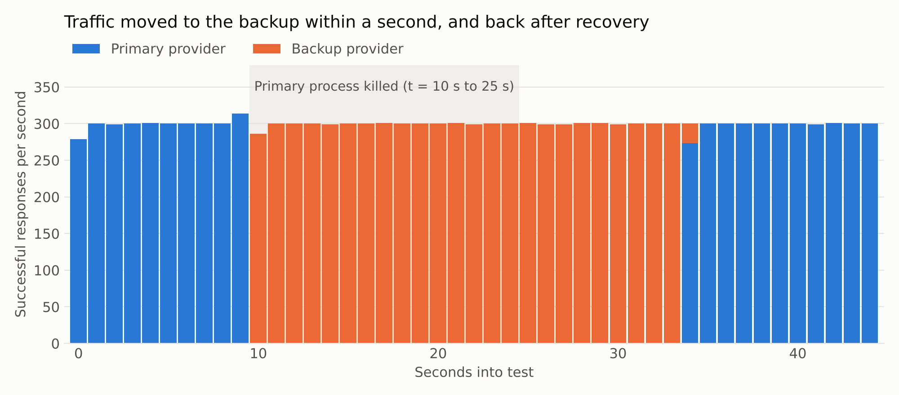

# Benchmarks

Every number here comes from `loadtest/bench.py` and is rendered into this file by `loadtest/report.py`. Raw output is
in `loadtest/results/results.json`.

## Test setup, and what it means for these numbers

- 2-vCPU cloud sandbox, Linux, release build with LTO, loopback networking.
- The gateway ran with **one worker pinned to one vCPU**. The mock provider and load generator shared the other.
- Upstream is `mock-upstream`, not a real model provider. Real provider latency is hundreds of milliseconds or more,
  and would dwarf the gateway's overhead.
- Load came from the included `loadgen`, because k6 was unavailable. Open-loop runs measure from each request's
  scheduled start, which avoids coordinated omission.
- TLS, real network latency and multi-core scaling are **not** covered.

## Added latency

Same open-loop load at 1,000 req/s, sent directly to the mock and then through the gateway. Time to first byte, median
of 3 rounds of 15 seconds.

| Path | Direct p50 | Gateway p50 | Added p50 | Direct p99 | Gateway p99 | Added p99 |
|---|---|---|---|---|---|---|
| Non-streaming | 0.616 ms | 0.776 ms | **0.160 ms** | 1.264 ms | 1.968 ms | **0.704 ms** |
| Streaming | 0.616 ms | 0.824 ms | **0.208 ms** | 1.296 ms | 2.000 ms | **0.704 ms** |

Added values are differences between percentiles. These requests bypass the cache but go through everything else: auth,
limits, JSON handling, connection pooling, metrics and logging. No requests failed.

## Maximum throughput on one core

Closed loop, 64 connections, 15 seconds, 50-token responses, no upstream delay. Latency here is at saturation, so it
reflects queueing and should not be read as overhead.

| Case | Requests/s | TTFB p50 | TTFB p99 | Errors |
|---|---|---|---|---|
| Mock provider directly (baseline) | 69,496 | 0.01 ms | 5.82 ms | 0 |
| Gateway, non-streaming, cache bypassed | **18,913** | 3.17 ms | 7.62 ms | 0 |
| Gateway, streaming, cache bypassed | **10,678** | 5.70 ms | 11.90 ms | 0 |
| Gateway, cache hits | **29,708** | 2.08 ms | 10.11 ms | 0 |

## Cache

1,000 req/s for 30 seconds, starting cold. Prompts drawn from 10,000 distinct values on a Zipf (s = 1.0) distribution,
with a 50 ms upstream.

| Metric | Result |
|---|---|
| Hit rate | **82.1%** |
| Upstream calls for 29,995 requests | 5,383 |
| TTFB p50 | 0.82 ms |
| TTFB p99 (cache misses) | 52.74 ms |
| Simulated spend avoided / spent | $19.20 / $4.19 |

Hit rate is a property of the workload. Zipf-distributed repeats are a favorable, chosen assumption, and real traffic
can be far lower. By default only `temperature: 0` or seeded requests are cached.

## Concurrent streams

2,000 simultaneous streams at 10 tokens per second, on one gateway core, with a 100 ms upstream TTFB.

| Metric | Result |
|---|---|
| In-flight requests observed | 2,000 |
| Errors | 0 |
| Gateway memory, idle → loaded | 4.6 MiB → 171.9 MiB |
| Memory per stream | 85.6 KiB |
| TTFB p50 / p99 | 109.6 ms / 323.6 ms |

The p99 reflects all streams starting and restarting in synchronized waves, which is harsher than real arrivals.

## Overload

3,000 req/s offered against 1,000 req/s of capacity (100 concurrent slots, 100 ms upstream), with a 100-slot queue
and a 200 ms queue timeout.

| Metric | Result |
|---|---|
| Served (200) | 19,711 (986 req/s) |
| Shed (503 with `Retry-After`) | 40,090 |
| Served request p99 | 202.8 ms |
| Overall median, dominated by immediate 503s | 0.95 ms |

Served-request latency stayed bounded by the queue timeout, and the gateway held throughput close to capacity.

## Upstream outage

300 streams per second for 45 seconds, with default breaker settings and a 1-second first-byte timeout. The primary
fails at t = 10 and recovers at t = 25.

| Failure mode | HTTP errors to clients | Streams cut off midway | TTFB p50 | TTFB p99 | Back on primary after recovery |
|---|---|---|---|---|---|
| Every request returns HTTP 500 | 0 | 0 | 21.2 ms | 24.3 ms | 9 s |
| Connections reset | 0 | 0 | 21.2 ms | 23.8 ms | 9 s |
| Accepts requests, never responds | 0 | 0 | 21.2 ms | 1024.0 ms | 2 s |
| Provider process killed | 0 | 15 | 21.2 ms | 24.8 ms | 9 s |



- **Streams already running when a provider dies cannot be saved.** In the crash run, 15 of 13,479 streams ended with an SSE error
  event. Those responses still count as HTTP 200, so they do not appear in the HTTP error column.
- **A hanging provider is the slowest failure to detect.** Requests during detection wait for the 1-second timeout,
  which shows up in that row's p99. With the default 30-second `first_byte_ms`, that wait would be up to 30 seconds.
- **Recovery lag is intentional.** The breaker backs off between probes, up to `max_open_ms` (10 seconds by default).

## Reproduce

```bash
cargo build --release
python3 loadtest/bench.py     # about 9 minutes; requires taskset and 2 or more cores
python3 loadtest/report.py    # requires matplotlib
```

`loadtest/k6-gateway.js` is provided for testing a deployed gateway. It has not been run.
