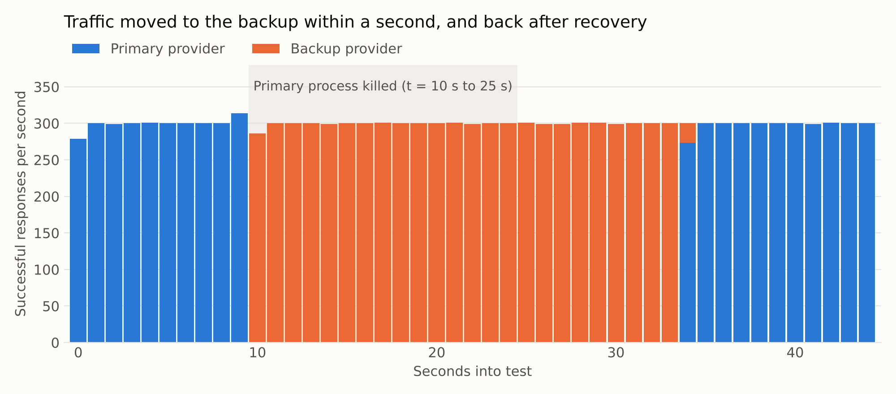

# LLM Gateway

A production-style gateway for language model APIs, written in Rust with **zero external dependencies**. It sits in
front of providers such as OpenAI and Anthropic, exposes one OpenAI-compatible endpoint, and adds streaming proxying,
per-key limits, caching, overload protection, automatic failover, and observability.

The async runtime (epoll), HTTP/1.1 stack, JSON parser and SHA-256 are all implemented in this repository.

## Results

Measured with the gateway on **one vCPU**, against a mock provider on loopback. See [BENCHMARKS.md](BENCHMARKS.md) for
the method and limitations.

| Measure | Result |
|---|---|
| Added latency at 1,000 req/s (p50 / p99) | 0.16 ms / 0.70 ms |
| Maximum throughput, cache bypassed | 18,913 req/s non-streaming, 10,678 req/s streaming |
| Maximum throughput, cache hits | 29,708 req/s |
| Cache hit rate, Zipf workload over 10,000 prompts | 82.1% |
| Concurrent streams on one core | 2,000 at 86 KiB each |
| 3x overload | 986 req/s served at capacity, served p99 203 ms, excess shed with 503 |
| Provider crash under load | 0 HTTP errors; 15 of 13,479 in-flight streams cut off |



## Features

- **Streaming proxy:** SSE passthrough with incremental framing, and backpressure from slow clients to the upstream.
- **Cost control:** client disconnects cancel the upstream request, and spend is tracked per tenant and provider.
- **Per-key limits:** requests per minute, tokens per minute, and a daily token quota, with reservation and settlement.
- **Overload protection:** concurrency cap, bounded queue with fairness between tenants, and fast 503s with `Retry-After`.
- **Caching:** sharded LRU with TTL, per-tenant isolation, streaming replay, coalescing of identical requests, and
  serving stale entries during outages.
- **Reliability:** retries with jitter and a retry budget, circuit breakers, and failover between providers, including
  translation between the OpenAI and Anthropic formats.
- **Observability:** Prometheus metrics, a Grafana dashboard, alert rules, W3C trace context, and structured JSON logs.
- **Operations:** graceful drain on SIGTERM, quota snapshots, health endpoints, hashed client keys, and strict HTTP
  parsing that rejects request-smuggling inputs.

## Try it locally

Linux with a recent stable Rust (tested on 1.97). On macOS, run these inside a Linux container. Python is needed only for `loadtest/`.

```bash
cargo build --release

./target/release/mock-upstream --listen 127.0.0.1:9100 --ttfb-ms 100 --tokens 30 --token-delay-us 30000 &
./target/release/mock-upstream --listen 127.0.0.1:9101 --ttfb-ms 100 --tokens 30 --token-delay-us 30000 &
DEMO_UPSTREAM_KEY=unused ./target/release/llm-gateway --config config/local-demo.json &

curl -N http://127.0.0.1:8080/v1/chat/completions \
  -H "Authorization: Bearer demo-key" \
  -d '{"model":"fast","stream":true,"messages":[{"role":"user","content":"hello"}]}'
```

Take the primary down and watch requests fail over to a provider that speaks a different API format:

```bash
curl -X POST http://127.0.0.1:9100/__control -d '{"mode":"error500"}'
curl -i http://127.0.0.1:8080/v1/chat/completions -H "Authorization: Bearer demo-key" \
  -d '{"model":"fast","messages":[{"role":"user","content":"hello"}]}'   # look for x-gateway-provider: backup
curl -s http://127.0.0.1:8080/metrics | grep gateway_breaker_state
```

## Layout

| Path | Contents |
|---|---|
| `src/rt/` | Thread-per-core epoll runtime, timers, async TCP |
| `src/http.rs` | HTTP/1.1 server parsing, client, chunked encoding |
| `src/gateway.rs` | The request pipeline |
| `src/limiter.rs`, `admission.rs`, `cache.rs`, `breaker.rs` | Limits, queueing, caching, circuit breaking |
| `src/translate.rs` | OpenAI and Anthropic translation |
| `src/mock.rs`, `src/bin/` | Fault-injecting mock provider and load generator |
| `tests/integration.rs` | End-to-end tests over real sockets |
| `loadtest/` | Benchmark harness, report generator, k6 script |
| `deploy/` | Docker Compose, Kubernetes, Prometheus, Grafana, TLS egress sidecar |

Read [docs/ARCHITECTURE.md](docs/ARCHITECTURE.md) for design decisions and known limitations, and
[docs/DEPLOY.md](docs/DEPLOY.md) to run it against real providers.

## Development

```bash
cargo fmt --check && cargo clippy --all-targets -- -D warnings && cargo test
```
